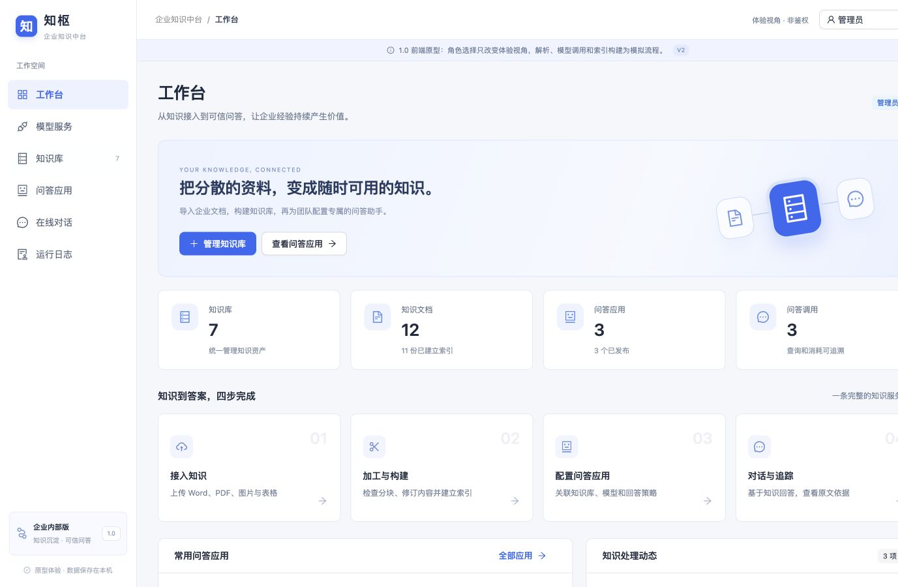
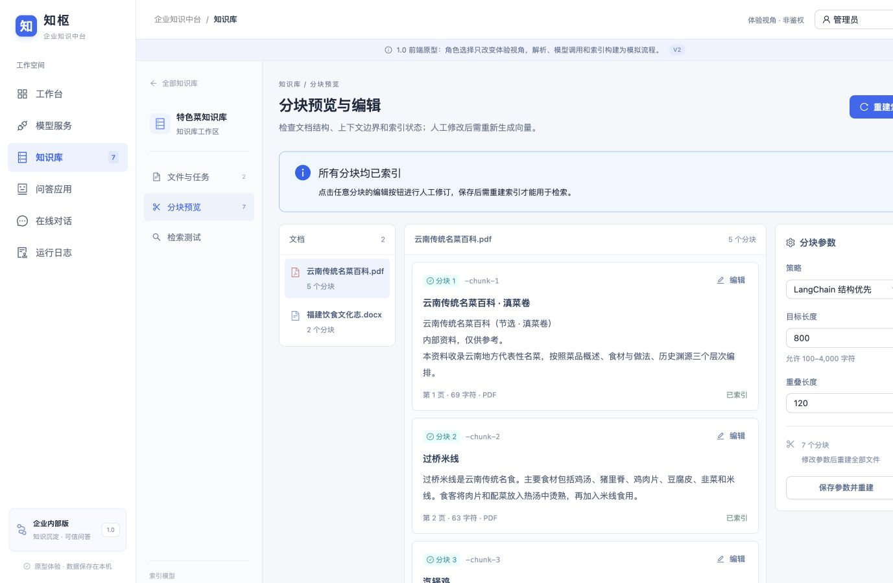

# 知枢 · 企业知识中台

面向企业内部知识服务场景的通用知识中台，目标是覆盖“配置模型 → 构建知识库 → 导入与分块 → 检索测试 → 发布问答应用 → 在线对话 → 运行日志与调用链观测”的完整流程。

> **当前边界**：React 已接入服务商／模型配置、图片异步 OCR、知识库管理、Markdown 原件上传、LangChain 持久化分块、版本化向量索引、向量检索与 Rerank、问答应用、LangChain SSE 多轮对话、不可变引用、Token 日志和真实问答 Trace；后端不可用时明确回退到本机演示。可观测阶段 A 已覆盖对话 Span、模型调用、异常事件和真实用量；知识库构建 Trace、完整上下文快照、价格规则后端与正式账单仍未实现。角色选择不是真实登录或服务端鉴权；Word／PDF／Excel 服务端解析仍未实现。云调用目前由测试替身验收，真实云账号、PostgreSQL／pgvector 和 Docker 基础设施尚未验收。

## 功能

- **工作台**：知识资产统计、知识服务流程、常用应用和处理动态。
- **模型服务**：管理 OpenRouter、AIHubmix、通义百炼，区分 LLM、Embedding、Rerank；连接后端后，配置保存与连接测试走真实 API，API Key 不进入浏览器存储。
- **知识库**：真实创建与设置、模型引用保护、文档与分块持久化、三栏分块工作区；保存参数会由 LangChain 重切，人工编辑会写回服务端并标记待索引。
- **版本化索引**：通过 LangChain `OpenAIEmbeddings` 批量构建真实向量，记录版本进度、维度、耗时和错误码；新版本全部成功后才替换活动版本，失败保留旧版本。当前尚未建立 HNSW 索引。
- **检索测试**：查询向量固定使用活动版本的 Embedding 模型，pgvector 余弦相似度召回候选快照，可配置阈值、候选数量和 Top K；Rerank 返回独立评分，失败不伪造结果。
- **知识导入**：整批真实 Markdown 走 FastAPI 上传、MinIO 原件保存与 LangChain 分块；混合格式保留明确标记的演示链路，图片可经通义异步 OCR 生成真实文本。Word／PDF／Excel 服务端解析尚未接入。
- **问答应用**：真实持久化应用配置，关联知识库，配置 LLM、提示词、Top K、候选池、相似度、Rerank、草稿与发布；发布时校验全部知识库和活动索引。
- **在线对话**：LangChain `ChatOpenAI` 流式生成、SSE 分包解析、多轮上下文、历史会话、停止生成和复制回答；引用保存活动索引原文快照，不受后续分块编辑影响。
- **运行日志**：持久化查询与回答、知识来源、模型、输入／输出／总 Tokens、首 Token／总耗时、状态和错误码；只使用服务商实际用量，未返回时明确显示“未提供”。
- **真实对话可观测**：记录 LoadConfig、逐库 Retrieval、QueryEmbedding、VectorSearch、可选 Rerank、MergeAndRank、BuildContext、LLM 和 PersistResult；提供真实总览、Run 筛选、调用树、瀑布时间轴、逐事件异常中心和 Token 分析。完整消息快照与构建 Trace 留待阶段 B，成本保持未知。
- **可观测原型回退**：后端未连接时仍可用明确标记的脱敏样例验收构建／对话 Trace、工具／Skill、完整上下文和价格规则交互，不代表真实监控数据。
- **角色视图**：管理员、知识库管理人员、使用者，包含菜单、数据范围和直接路由检查。
- **响应式布局**：桌面端三栏工作区及移动端导航和主要页面适配。

## 页面预览





## 技术栈

- 前端：React 19、TypeScript 5、Vite 7、React Router 7、Ant Design 6
- 后端：FastAPI、SQLAlchemy 2、Alembic、LangChain Python
- 数据与任务：PostgreSQL／pgvector、MinIO、Redis、Celery
- 部署与测试：Docker Compose、Vitest、Playwright、pytest、Ruff

## 本地运行

要求 Node.js 20 或更高版本。

```bash
npm ci
npm run dev
```

开发服务器默认监听 `http://127.0.0.1:4173`，首页路由为 `/workbench`。如果端口被占用，以终端输出为准。

常用页面：

```text
/workbench
/models
/knowledge
/knowledge/cuisine?tab=chunks
/applications
/chat
/logs
/observability
/observability/runs/run-chat-031
/observability/errors
/observability/usage
```

## 测试与构建

```bash
# 48 项单元／组件／API 契约测试
npm test

# 28 项浏览器端到端测试，需要本机 Google Chrome
npm run test:e2e

# TypeScript 检查与生产构建
npm run build

# 预览 dist
npm run preview
```

端到端测试覆盖角色权限、文件导入、知识索引与检索、问答发布、多轮对话、历史会话、停止生成、引用与日志、模型引用保护、任务清理和移动端布局；另以 HTTP 替身验收服务商／模型、图片 OCR、联机 Markdown、索引激活、检索 Rerank，以及应用创建、SSE 分包回答、不可变引用和 Token 日志等 API 路径。可观测测试同时保留脱敏原型交互，并联机验收真实 Run、Trace、异常、未知用量、CSV 导出与价格规则边界，不会把样例或替身响应伪装成真实云账号验收。测试由 Playwright 自动启动并关闭临时开发服务器。

## 数据与状态

本机演示数据保存在当前浏览器的 Local Storage：

- `knowledge-hub-workspace-v3`：演示知识库、文档、分块、任务、模型、应用、会话和日志；联机知识数据刷新后以服务端响应为准。
- `knowledge-hub-role-v3`：当前体验角色。

演示数据按浏览器 Origin 隔离，不会跨设备或跨端口共享。真实知识库、文档元数据、分块、索引版本、向量快照、应用、会话、消息、引用快照、查询日志和对话 Trace 保存在 PostgreSQL，Markdown 原件保存在 S3／MinIO；图片选择云端 OCR 后会上传至后端及通义服务商。Word／PDF／Excel 仍使用明确标记的示例解析结果。API Key 只提交给 FastAPI，不保存到浏览器存储。

## 后端与完整部署

技术选型和完整架构见 [后端 1.0 设计](docs/backend-design-v1.md)，本地开发、接口和测试说明见 [后端 README](backend/README.md)。

已确认的组合为 FastAPI、SQLAlchemy／Alembic、PostgreSQL、MinIO、Redis／Celery 和 LangChain。当前可用接口包括服务商与模型配置、模型连接测试、通义 OCR、知识库、Markdown 原件、分块、版本化向量索引、向量检索与 Rerank、问答应用、会话、SSE 问答、查询日志和阶段 A 可观测查询。异步状态和业务数据持久化在数据库，Redis 不是唯一任务记录。

前端通过 `src/api.ts` 调用同源 `/api/v1`，Vite 开发服务器将 `/api` 代理到 `http://127.0.0.1:8000`；部署时可用 `VITE_API_BASE_URL` 覆盖。真实 OCR 与索引构建需要同时运行 FastAPI、Worker、PostgreSQL、Redis 和 S3／MinIO；真实检索、问答与对话 Trace 需要 FastAPI、PostgreSQL／pgvector 和有效模型服务商；真实知识库与 Markdown 链路需要 FastAPI、PostgreSQL 和 S3／MinIO，只启动前端不会完成服务端持久化。

```bash
cp .env.example .env
# 按 .env 中的说明生成并填写 HUB_ENCRYPTION_KEY
docker compose up --build
```

完整部署将启动前端、API、独立 Worker、PostgreSQL／pgvector、MinIO 和 Redis。当前开发机没有 Docker，以上编排只做了静态校验；真实云模型也需要配置有效账号后另行联调。

后续阶段包括 Word／PDF／Excel 服务端解析、HNSW 索引、知识库构建 Trace、完整上下文快照、异常指纹聚合和价格规则后端。阶段 A 数据模型、埋点、原文权限和成本边界见 [可观测模块设计](docs/observability-design-v1.md)，下一步进入阶段 B。

## 主要源码

```text
src/HubApp.tsx             当前七个模块及主要交互
src/RemoteChat.tsx         真实应用、SSE 在线对话与 Token 日志
src/Observability.tsx      真实／原型可观测总览、Run、Trace、异常与用量页面
src/useObservability.ts    观测 DTO 映射、真实数据加载和原型回退
src/observabilityData.ts   脱敏原型夹具、筛选与用量计算
src/observability.css      可观测页面与响应式样式
src/api.ts                FastAPI 客户端、SSE 解析、错误处理与 OCR 轮询
src/hub.css               页面样式与响应式规则
src/workspace.ts          数据类型、种子数据、分块与检索模拟
src/permissions.ts        角色、菜单与路径权限
src/*.test.ts(x)          单元／组件／API 契约测试
e2e/hub.spec.ts           浏览器端到端回归
```

`src/App.tsx`、`src/styles.css` 和 `src/mockData.ts` 为早期版本保留源码，不是当前运行入口。

## License

本项目基于 [MIT License](LICENSE) 开源。
